# SurgiGuard AI: every interface, explained

This is a visual tour of the running system. For each screen it explains **who it is for**, **what you see**, **what happens behind it** (code, rules, local model or AI), and **where the code is**.

All screenshots were taken from the real running system on a laptop with **no hardware**:
- a virtual ESP32 sends data over MQTT (see `scripts/simulate_device_mqtt.py`);
- the AI runs on free Groq and Mistral tiers;
- the wound model runs locally.

They were taken automatically by `scripts/docs_screenshots.py`; run it again after any UI change. The patient is fictional.

| Interface | URL | User |
|---|---|---|
| [1. The story page](#1-the-story-page-story) | `/story` | professor / jury: the whole chain on one page |
| [2. Patient app](#2-patient-app-app) | `/app/` | patient (Sarah) |
| [3. Family app](#3-family-app-app--im-a-family-member) | `/app/` (family role) | caregiver (Ahmed) |
| [4. Clinic workspace](#4-clinic-workspace-agent-demo) | `/agent-demo/` | clinician (Dr Ruiz), plus demo controls |
| [5. D1·D2·D3 console](#5-d1d2d3-console-prototype) | `/prototype` | developers: each AI area step by step |
| [6. API docs](#6-api-documentation) | `/docs`, `:5051/swagger` | developers |

The app's web build shows three tabs at the top: **Patient & family app**, **Clinic** and **Family overview**. They only exist on the web, to move between views during a demo; the phone app does not have them.

---

## 1. The story page (`/story`)

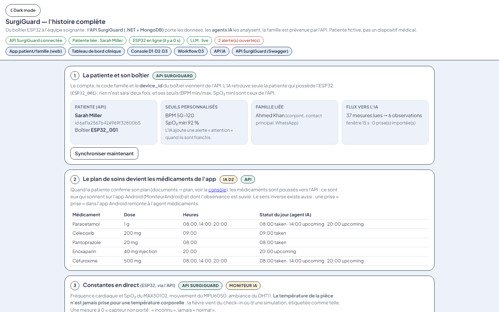

**For:** anyone who wants to see the whole chain at once. Start the demo here.

**The status chips** at the top are live:
| Chip | Meaning | Where it comes from |
|---|---|---|
| API SurgiGuard connectée | the AI backend can reach the .NET API | `GET /hub/status` → `integrations/surgiguard_api.py` |
| Patiente liée : Sarah Miller | the API patient who owns `ESP32_001` is found | same |
| ESP32 en ligne (il y a 0 s) | last reading less than a few seconds old (the virtual ESP32 is publishing) | MQTT → `MqttBridgeService.cs` → MongoDB → poll every 3 s |
| LLM : live | the AI uses a real model (otherwise *stub*) | `backend/.env` |
| N alerte(s) ouverte(s) | open alerts in the AI backend | `alerts.py` |

**The numbered sections** tell the story in order:
1. **The patient and her device**: API patient, personal thresholds (BPM 50–120, SpO2 at least 92%), linked family member. "Flux vers l'IA" shows *37 readings received → 6 observations*: readings are averaged over 15 s windows before the Monitor sees them.
2. **The care plan becomes the app's medications**: the confirmed plan is pushed to the API, and today's dose status comes from the medication agent (rules only, no AI).
3. **Live vitals** (the last 3 minutes of BPM and SpO2) and **what the Monitor decided** for each reading. A reading of 0 means the sensor is not worn: "unknown", never "normal".
4. Further sections cover the check-in, the investigation (LangGraph), family notification, the clinician closing the loop, expected recovery and the twin, camera rehab, guided movement tests, and the assistants (RAG with sources, family evening summary).

The buttons on the page inject the same events as the clinic page (fever, fall, low SpO2…), always labelled as simulated.

Code: `backend/web/story.html`, `backend/app/routers/hub.py`.

---

## 2. Patient app (`/app/`)

React Native code (`mobile/src/`). The same code runs on Android; here it is the web build (react-native-web).

### 2.1 Onboarding
| | | |
|---|---|---|
| 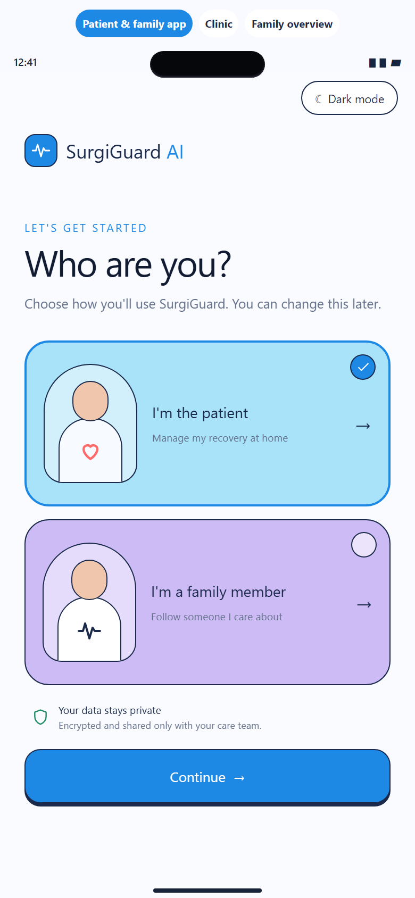 | 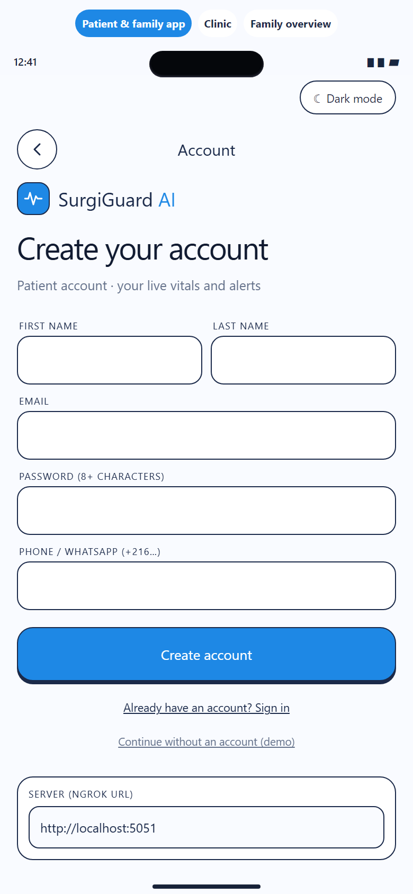 | 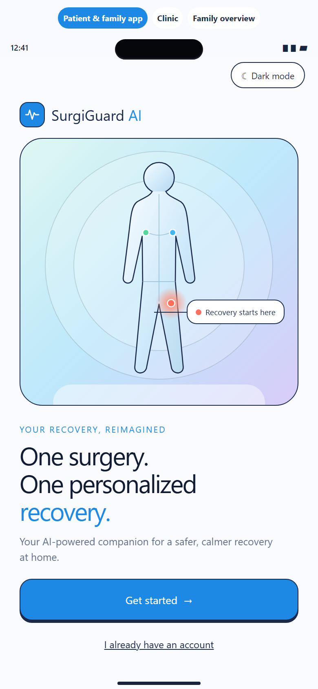 |
| **Who are you?** Patient or family member. The role decides which half of the app opens. `RoleSelectionScreen.tsx` | **Account** on the .NET API (`POST /api/auth/register`), or **Continue without an account (demo)**, which uses the AI backend's fictional Sarah. `AuthScreen.tsx` | **Welcome.** `WelcomeScreen.tsx` |

### 2.2 Documents → care plan (D2: OCR + AI + code checks)
| | |
|---|---|
| 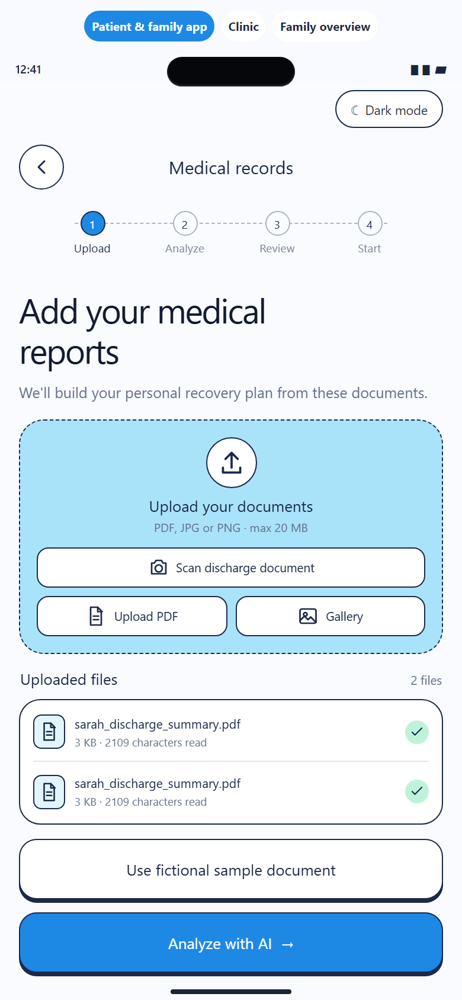 | 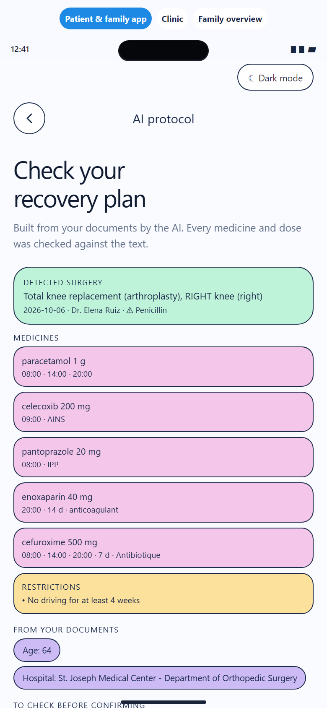 |

1. **Upload** (`UploadScreen.tsx`): scan, PDF or gallery, or the fictional sample discharge summary.
2. **Analyze with AI**:
   - The text is extracted by **PyMuPDF**. For a scanned page the image goes to **Mistral Pixtral**, a vision model used for OCR (`services/ocr_service.py`).
   - Then an LLM fills a strict schema (`agents/protocol.py`, `ai/graphs/protocol_graph.py`).
3. **Check your recovery plan** (`ProtocolScreen.tsx`):
   - It shows the detected surgery (right total knee replacement, allergy ⚠ penicillin), the **5 medicines with doses and times**, and the restrictions.
   - **Code checks that every medicine, dose and time appears in the document**; anything else becomes a "check this" warning.
   - The **D2 safety check** found a real interaction: *enoxaparin (anticoagulant) + celecoxib (anti-inflammatory) → higher bleeding risk*.
   - **Missing fields** are listed instead of guessed: weight, height, smoking, diabetes, ASA score.
4. **Confirm my plan**: only the patient's confirmation makes the plan active. Safety settings (red flags, thresholds) are **never** taken from the AI.

### 2.3 Home
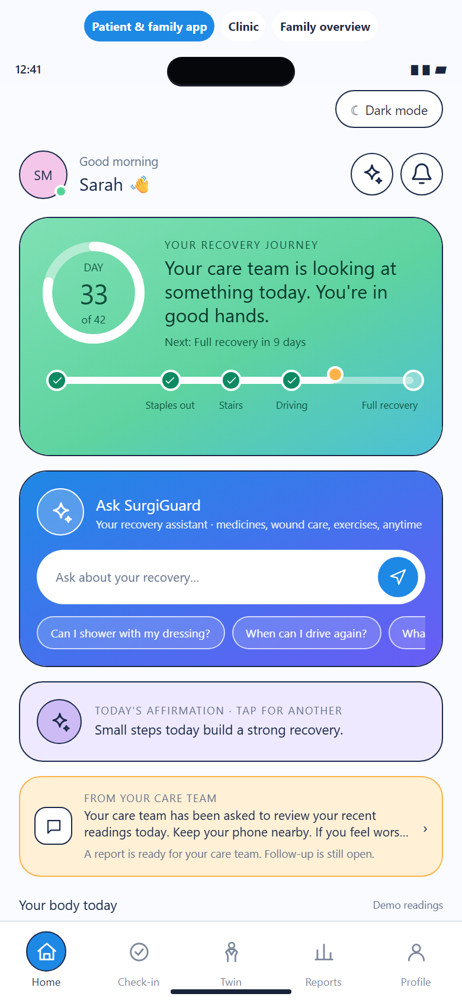

`HomeScreen.tsx`:
- **Recovery journey**: day 33 of 42, with milestones (staples out, stairs, driving).
- **Ask SurgiGuard**: the assistant.
- **From your care team**: requests from the agents (for example "add a wound photo at this dressing change" or "your care team was asked to review your readings").
- **Your body today**: vitals.
- **Medications**: the next dose.
- **Knee rehab**: progress.

The bottom tabs are Home, Check-in, Twin, Reports and Profile.

### 2.4 Recovery assistant (D2B, RAG)
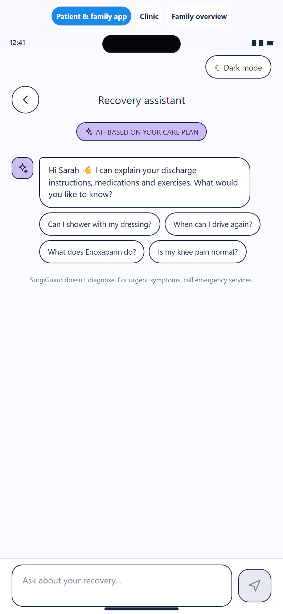

`AIAssistantScreen.tsx` → `POST /chat` (`routers/chat.py`), model chosen by `LLM_ROUTE_CHAT`.
- It answers **only from the patient's own active plan**: the plan is split into chunks, indexed with FAISS, and the relevant passages are retrieved for each question (`ai/rag/`).
- An urgent phrase ("I can't breathe") is caught by the **red-flag gate before any AI is called**, and sends the patient to the urgent path.
- "SurgiGuard doesn't diagnose" is enforced by `safety/output_guard.py`.

### 2.5 Daily check-in, movement tests, rehab and wound scan
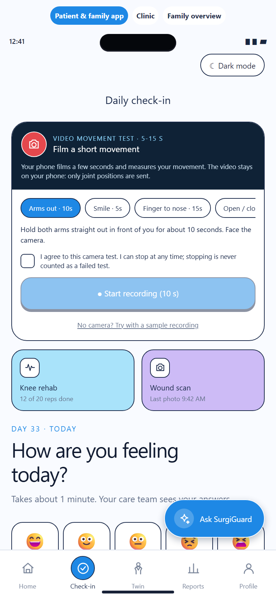

`CheckInScreen.tsx`:
- **Video movement test** (5–15 s: arms out, smile, finger to nose…):
  - MediaPipe runs **on the phone or in the browser**, and **only joint positions are sent; the video never leaves the device**;
  - consent is opt-in, and stopping never counts as a failed test;
  - analysis in `d1/neuro/` compares left and right; a result can raise "attention" for the clinician, never an emergency.
- **Knee rehab**: reps and range of motion from MediaPipe landmarks (`d1/rehab/`).
- **Wound scan**: the dressing-change photo (§2.6).
- **How are you feeling today?**:
  - 0–10 sliders and symptom chips;
  - urgent rules run **first** (`safety/urgent_rules.py`);
  - then at most **one** clarifying question if something got worse (`agents/checkin.py`).

### 2.6 Wound scan (your part: D1-F)
The **Wound scan** tile is on the Check-in screen above. The full analysis result is shown in the clinician view (§4.2).

`WoundScanScreen.tsx` (camera) / `WoundScanScreen.web.tsx` (file upload in the browser) and `components/WoundAnalysis.tsx`:
- The photo is accepted **only at a dressing change allowed by the care plan**, and after the patient ticks "I am changing my dressing now". A dressing must never be removed just to take a photo.
- The patient sees the outline, the quality check, the comparison with the first photo, and 4 attributes in plain words.
- The patient **never** sees "risk" or "urgency"; those are for the clinician.

The full pipeline is in [wound/01_HOW_V1_WORKS.md](wound/01_HOW_V1_WORKS.md), and the clinician view is in §4.2.

### 2.7 Recovery Twin
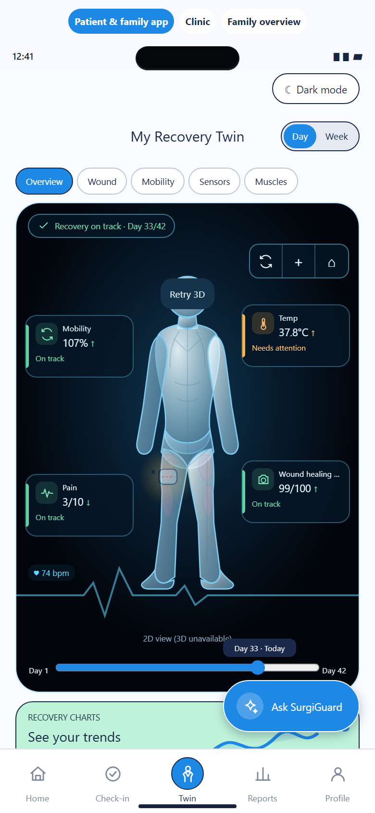

`TwinScreen.tsx`:
- A 3D body (three.js; it falls back to a 2D view if WebGL is unavailable) with cards for mobility, temperature, pain and wound healing, each marked "on track" or "needs attention" against the **expected recovery for this day** (D1 `trajectory_prediction`).
- Tabs: Overview, Wound, Mobility, Sensors, Muscles.
- A day slider from day 1 to day 42.
- The **Patient Twin forecast** (D1 `patient_twin`) predicts the next hours of HR and SpO2 with an 80% band, or **abstains** if there is too little data.

### 2.8 Reports
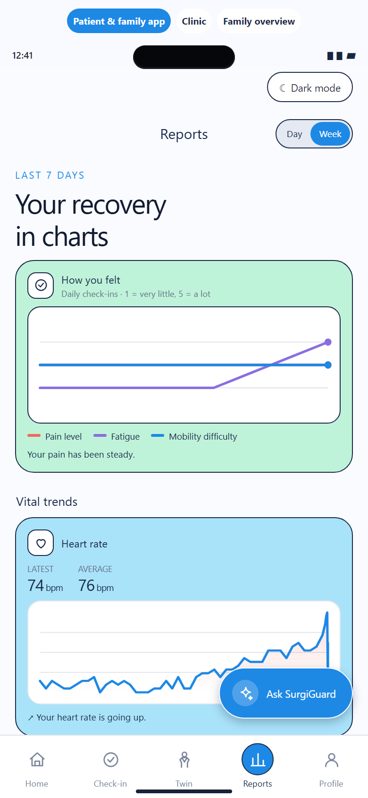

`ReportsScreen.tsx`: 7-day charts of check-ins (pain, fatigue, mobility) and vital trends.
- The heart-rate curve here is **the virtual ESP32's stream**: you can see the simulator's walks and the heart-rate rise phase.
- The trend sentence ("Your heart rate is going up") is computed by code.

### 2.9 Medications
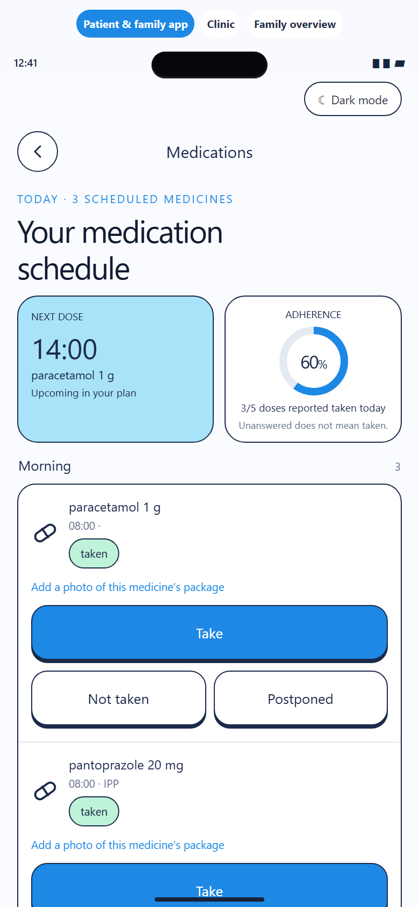

`MedicationsScreen.tsx`: today's schedule from the confirmed plan.
- Dose answers: taken, not taken or postponed.
- **No answer after the grace period counts as "unknown", never "taken"** (`agents/medication.py`, rules only).
- 2 or more missed doses in 48 h → a caregiver task plus a flag for the clinician.

---

## 3. Family app (`/app/` → "I'm a family member")
| | | |
|---|---|---|
| 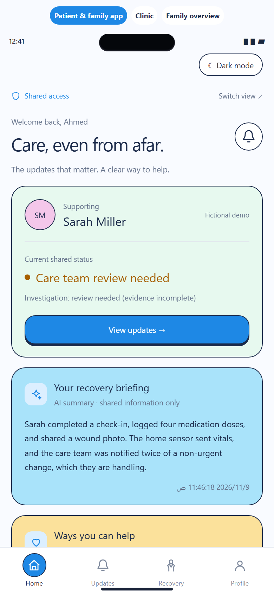 | 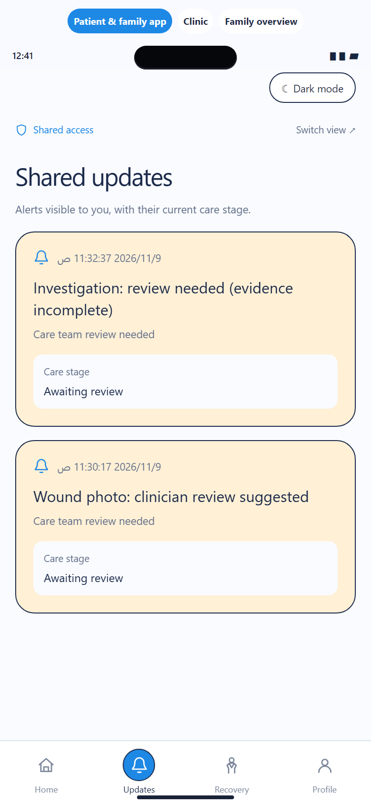 | 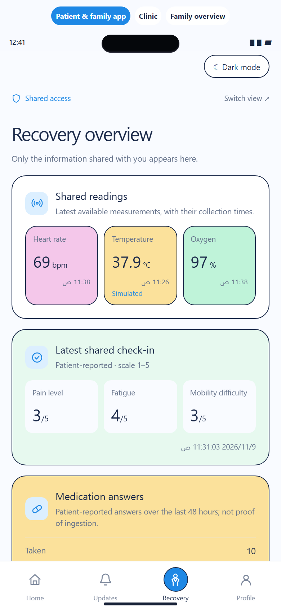 |

`mobile/src/screens/family/`:
- **Home** (`FamilyHomeScreen.tsx`):
  - **Current shared status**, here "Care team review needed: Investigation: review needed". The family sees *that* the care team is on it, not the clinical details.
  - **Your recovery briefing**: an AI evening summary written **only from events the patient allowed**. The events are filtered **before** the AI sees them; the summary is then checked (80 words at most, no clinical interpretation) and falls back to a template if a check fails (`agents/digest.py`).
  - **Ways you can help**: practical tasks.
- **Updates**: shared alerts and notifications. In production, family members also get push or WhatsApp messages through the .NET API (`AlertService.cs`: severity 1 → push; 2 → + WhatsApp to the main contact; 3 → + WhatsApp to everyone opted in). These are simulated in the demo.
- **Recovery**: progress that the patient shares.

**Permission model:** Sarah chooses the categories (symptoms, medications, readings, wound updates, alerts, rehab, appointments). Medical decisions always stay with the care team.

---

## 4. Clinic workspace (`/agent-demo/`)

One page with three columns for the demo: **patient app**, **family app** and **care-team watchlist**. The **demo controls** at the top inject situations.

### 4.1 Demo controls and watchlist
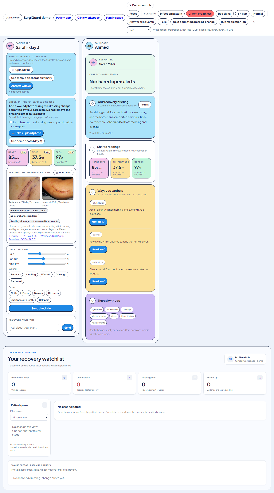

| Control | What it does |
|---|---|
| Reset | back to the clean fictional episode (`POST /demo/reset`) |
| Scenarios: Infection pattern, Urgent breathless, Bad signal, 6 h gap, Normal | inject observation series (`POST /demo/scenario/{name}`) |
| Answer all as Sarah | answer the agent's pending questions to the patient |
| +61 s | move the demo clock (acknowledgement timeouts, escalation) |
| Next permitted dressing change | open the next photo window of the care plan |
| Run medication job | run the medication agent now |
| live / stub / off | switch the AI mode live: **off** shows that urgent alerts still fire when the AI is down |

The watchlist shows patients on watch, urgent alerts, cases awaiting care, follow-up, the patient queue, and the selected case.

### 4.2 Wound photo review: what you will present
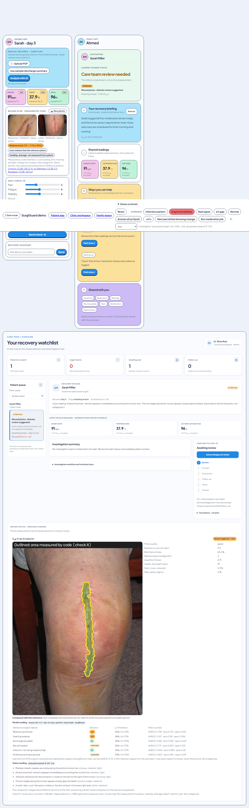

After "Use demo photo (day 3)" (with "I am changing my dressing now" ticked):

1. **Left column (patient view):** reference vs latest photo, redness area 5.7% → 7.7% (+35%), and "more redness than the reference photo". This chip comes from the **older analyser `wound_image.py`**: one of the problems v2 fixes (two analysers, see journal A2).
2. **Family column:** "Care team review needed: Wound photo: clinician review suggested". The family gets the *status*, never the medical content.
3. **Watchlist → case:** an *attention* alert, "Wound photo: clinician review suggested", with the vision reading quoted as the reason. The **follow-up steps** are on the right: Review → Contact → Care action → Follow-up → Close → Closed. Only a clinician can move it forward.
4. **Wound photos panel** (bottom), in four parts:
   - **"Outlined: area measured by code (check it)"**: the **OpenCV** outline of the incision along the staple line, so a human can verify what was measured.
   - **Measurement table**: quality *good*; redness Δa\* 9.9 vs own skin; red share 63.4%; redness beyond edge 4; area 2.71% of frame; 37 staple-like marks; dark/crust 2.3%; pale-yellow 0%.
   - **"Compared with the reference: Not compared"**: the two demo photos are of **different patients**, so ORB found only 10 consistent points and the comparison was **refused** instead of showing a fake change.
   - **Model reading, local** (CLIP ViT-B/16 + heads, SurgWound):

     | Attribute | Decision | p / threshold |
     |---|---|---|
     | redness | **yes** | 46% / 32% |
     | swelling | **yes** | 48% / 37% |
     | discharge | no | 28% / 40% |
     | not healed | **uncertain** (inside the ±5% band) | 36% / 37% |
     | infection-risk rating | no | 25% / 33% |
     | professional review advised | **uncertain** | 34% / 30% |

     Each row also shows the held-out test AUROC, sensitivity and specificity.
   - **Vision reading** (free Groq Qwen 3.8, live):
     - "multiple metallic staples along the vertical incision line (high)";
     - "band of pinkish-red skin immediately surrounding the incision (high)";
     - "yellowish and brownish discoloration… (bruising, high)";
     - "edges appear closely approximated (medium)";
     - then its own uncertainty statement. Diagnosis words would have been removed by code.
   - The badge **"Review suggested → alert"** is the decision of the **code rule** (`decide()`), not of the AI alone.

Code: `backend/web/index.html` (`renderWoundClinic`, `renderWoundModel`), `backend/app/integrations/d1_wound.py`.

### 4.3 Alerts and investigation


After the **Infection pattern** scenario:
1. The **Monitor** (code) sees rising temperature and heart rate and opens an **investigation**.
2. The **investigation agent** (LangGraph, Groq gpt-oss-120b) reads the readings and check-ins and may **ask Sarah a question** (shown in her app under *Requests*).
3. "Answer all as Sarah" answers it.
4. The agent writes an **evidence summary**. Every claim must cite a real observation (`agents/evidence.py`); otherwise a rule-based summary is used.
5. The clinician acknowledges and closes the loop. Every step is audited.

---

## 5. D1·D2·D3 console (`/prototype`)
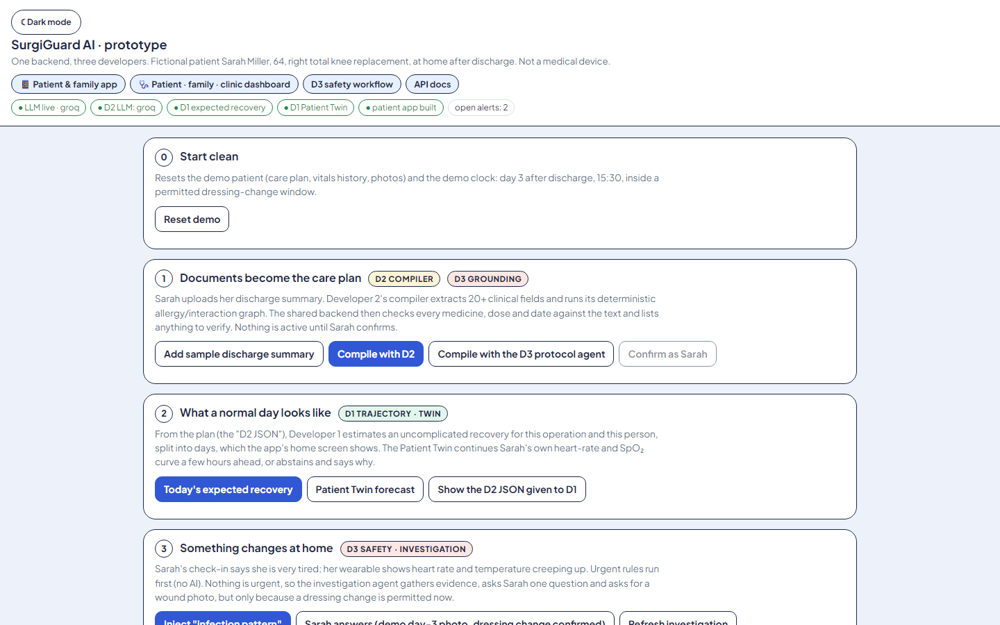

`backend/web/prototype.html`: one button per step of the story, grouped by AI area.
- **D2:** documents become the care plan. Add the sample, compile with D2, confirm as Sarah, show the "D2 JSON" handed to D1.
- **D1:** today's expected recovery, Patient Twin forecast, "what a normal day looks like".
- **D3:** something changes at home (inject the infection pattern), the safety workflow, the check-in form with calf pain, refresh the investigation, the care team closes the loop, the family digest.
- **Assistants:** "Try: *I suddenly can't breathe*" shows the red-flag gate stopping the AI.

---

## 6. API documentation
| AI backend `http://localhost:8000/docs` | .NET API `http://localhost:5051/swagger` |
|---|---|
| 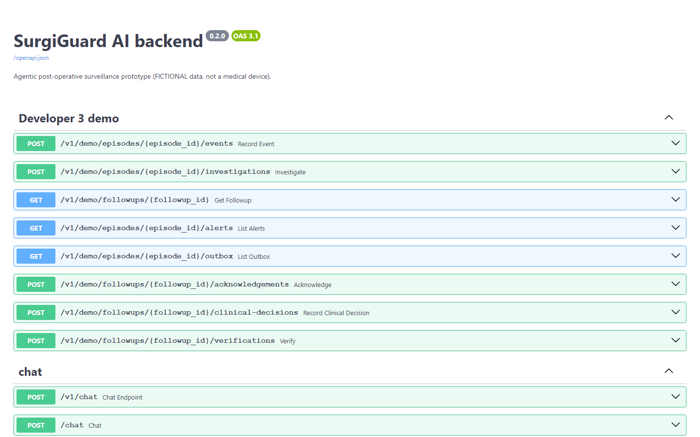 | accounts, patients, devices, telemetry ingest, medications, family, alerts |

Both can be called directly from the browser ("Try it out").

---

## How to reproduce these screens
```powershell
.\scripts\demo.ps1                                                     # start everything
backend\.venv\Scripts\python.exe scripts\docs_screenshots.py           # retake every screenshot
backend\.venv\Scripts\python.exe scripts\docs_screenshots.py --only clinic
```
