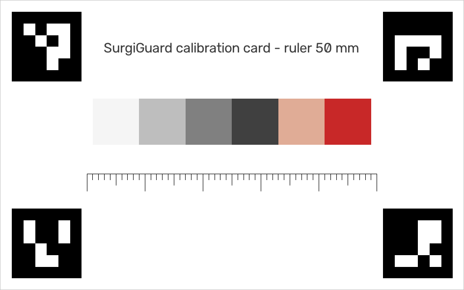
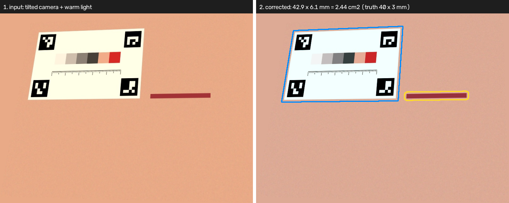

# Wound CV v2, step 2: the calibration card

**Goal:** give every wound photo a **real size** (mm, mm², cm²) and a **corrected colour**, so that two photos taken on different days, from different distances and under different lights can be compared honestly.

Code:
- `d1/src/surgiguard_d1/wound/calibration.py`
- `card_render.py`
- `d1/scripts/make_calibration_card.py`

Tests: `d1/tests/test_wound_calibration.py`.

Problems met while building it: journal entries V11–V14 in [02_PROBLEMS_AND_SOLUTIONS.md](02_PROBLEMS_AND_SOLUTIONS.md).

---

## 1. Why a card?

A single phone photo has two unknowns that v1 could not remove (audit A4, A5):

| Unknown | Consequence in v1 | With the card |
|---|---|---|
| **Scale**: how many pixels is one millimetre? | area reported as "% of the frame", which changes with every camera distance; kernel sizes in pixels have a different physical size in every photo | the marker corners give the exact mapping pixels → millimetres |
| **Light colour**: warm lamp, daylight, flash | every pixel shifts; v1 could only compare with the patient's own skin in the same photo | the grey patches show the colour cast, which is then removed |

This is the same idea as the paper rulers nurses already place next to wounds in wound-care photography, made machine-readable.

## 2. The card



Printable sheet: [`calibration_card.pdf`](calibration_card.pdf) (A4, 4 cards).
- Print at **100% / actual size**.
- Check that the ruler measures exactly **50 mm**.

| Element | Size / position (mm, from top-left) | Purpose |
|---|---|---|
| Card | 80 × 50 | small enough to sit next to an incision |
| 4 ArUco markers (`DICT_4X4_50`, ids 0–3) | 12 × 12, 2 mm from each corner | 16 corners at known positions → homography; each marker is identified, so orientation and partial views work |
| 4 neutral patches: white, light grey, mid grey, dark grey | 8 × 8, y = 17 | fit the colour correction |
| Skin-tone and red patches | 8 × 8, y = 17 | **not** used for fitting; used only to *measure* the remaining colour error (an honest check) |
| Ruler | 50 mm, 1 mm ticks | check the print scale by eye |

Every size lives in one immutable value object, `CardSpec`. Both the renderer and the detector read it (DRY), so the printed card and the code can never disagree.

**How to use it:** place the card flat on the skin next to the wound (not on it), fully visible, with the phone roughly parallel to the skin.

## 3. How it works

```
photo ─► detect ArUco markers (sub-pixel corners) ── fewer than 2 ──► "no card": v1 behaviour, sizes relative
            │ ≥ 2 markers (≥ 8 corners)
            ▼
   RANSAC homography  H : image px → card mm
            │
            ├─► local scale at the card centre (px per mm) + tilt ratio ── too oblique ──► refused, with advice
            ├─► card mask (card outline + 1.5 mm) → excluded from skin, wound and background
            ├─► sample the 6 patches (median, 1.5 mm inset) → fit colour model on the 4 neutrals
            │        └─ residual ΔE of ALL 6 patches; fit refused if it does not explain them
            ▼
   corrected image → quality → segmentation (card ignored, kernels in mm) → measurements + real size
```

### 3.1 Geometry: the homography
- The 4 markers give up to 16 point pairs (pixel ↔ millimetre). `cv2.findHomography(..., RANSAC)` fits the 3×3 projective map `H`, which models **perspective**: a phone tilted 20° still measures correctly.
- **Scale and tilt.** At the card centre, the Jacobian `J` of the mm→px map gives `px_per_mm = √|det J|`. The ratio of its singular values is the **tilt ratio** (1 = camera parallel; above 2 the photo is refused as too oblique).
- **Exact area (V11).** Each pixel covers a slightly different area under perspective. For `H = [[h11 h12 h13], [h21 h22 h23], [h31 h32 h33]]`, the area of the pixel at (x, y) is exactly

  `|det J(x, y)| = |det H| / (h31·x + h32·y + h33)³`   (in mm² per pixel)

  The wound area is the sum of this over all wound pixels.
- **Length and width:** minimum-area rectangle of the outline's outer pixel corners, mapped to millimetres.
- **Assumption, written into every result:** the card lies flat on the skin, in the same plane as the wound. A strongly curved body part, or a card held in the air, breaks this.

### 3.2 Colour: white balance in linear light
- Light acts by **multiplication** on physical intensity. The sRGB values in a JPEG are gamma-encoded, so the correction is done after converting to **linear RGB** (the standard sRGB transfer function), and converted back afterwards.
- For each channel, `lin_out = gain · lin_in + offset` is fitted by least squares on the 4 neutral patches. Greys are used because a printer reproduces neutral greys far more reliably than saturated colours.
- **Quality check.** ΔE76 in CIELAB is computed between the corrected patches and their printed values, for all 6 patches (including skin and red, which were not fitted). If the error after the fit is still above 12, the colour model is discarded and only the geometry is used.

### 3.3 The card must never become a "wound" (V12)
- The card's black markers and white paper are excluded from the skin mask and from the wound search (`ignore` mask in the `Segmenter` interface).
- That was **not enough**. The segmenter compares each pixel with its *local background* (a large Gaussian blur), and the bright card leaked into the background of the skin beside it. That skin then looked "darker than its surroundings" and was segmented as a wound.
- The fix is a **normalized convolution**: `background = blur(x·w) / blur(w)`, with `w = 0` on the card.

### 3.4 Sizes in millimetres, not pixels (V13)
- When the scale is known, all kernel sizes (`config.Kernels`) are converted with `Kernels.scaled(px_per_mm)`, so they keep the same **physical** size at any camera distance.
- Comparisons between two calibrated photos use real **mm²** (`area_basis: "mm2 (calibration card)"`) instead of "frame share corrected by the registration scale".

## 4. Results (synthetic photos with known ground truth)



The test scene:
- a skin plane at a known scale with a **40 × 3 mm incision** (120 mm²) and the card beside it;
- then a camera tilt (perspective) and a warm light (linear-RGB cast).

| Test (`test_wound_calibration.py`) | Result |
|---|---|
| Flat photo: scale recovered | within **2%** |
| Tilted photo, true outline mapped through the homography | area within **5%**, length within **3%**, width within 0.5 mm |
| Warm light | colour error **ΔE 9.5 → 2.1**; the white patch is white again (±8 levels) |
| Pure gain, exact maths | gains recovered to 0.1%, offset ≈ 0 |
| Card never segmented | the wound mask never overlaps the card mask |
| Same wound from two distances | real-area change within 15% |
| Missing or partial card / too oblique | refused with a reason ("only 2 markers visible", "photo too oblique") |
| No card at all | outputs **identical to v1** (9-case regression) |

**Honest limit (V14).**
- End-to-end, the length is good (42.9 mm vs 40), but the **width and area are about 2× too large** (6.1 mm, 2.44 cm² vs 3 mm, 1.2 cm²).
- The calibration is not the cause: on the true outline, the geometry is within 5%. The cause is the **classical segmenter**, which grows its mask by about 1.4 mm on each side to make sure the wound edge is included. That margin is large next to a 3 mm wide incision.
- The calibration therefore makes the segmenter's error **visible in millimetres**. Fixing it is the job of step 3: a learned segmenter, scored with Dice/IoU against true outlines.

## 5. Design (how it fits the v2 architecture)

| Element | Role | Pattern / principle |
|---|---|---|
| `CardSpec`, `Patch` | every size of the card, in mm | immutable value objects, single source of truth |
| `CardCalibrator` | detection + fitting, stateless | **component injected** into `WoundAnalyzer(calibrator=…)` (DI); swappable, for example for another card design |
| `Calibration` | result: homography, scale, tilt, card mask, colour model, residual error | immutable value object with behaviour (`to_mm`, `pixel_area_mm2`, `metric_size`) |
| `ColourModel` | per-channel affine model in linear RGB | value object; `fit_colour_model()` is a pure function |
| `NOT_FOUND` | the "no card" result | Null Object: callers never test for `None` |
| `Segmenter.segment(bgr, ignore, px_per_mm)` | the interface grew 2 optional arguments | Open/Closed: existing segmenters keep working |
| `card_render.render_card` | draws the card from `CardSpec` | used by the print script **and** by the tests' synthetic photos |

## 6. What is not solved yet
- Validation on **real printed cards photographed with real phones**: printer colour accuracy, paper gloss and glare, auto-exposure. The synthetic tests prove the maths, not the field conditions.
- A full 3×3 colour-correction matrix (currently per-channel only, which is enough for the light colour but not for camera-specific colour rendering).
- Curved body parts (knee, shoulder), where the card plane and the wound plane differ.
- Measuring the segmentation error itself: step 3.
