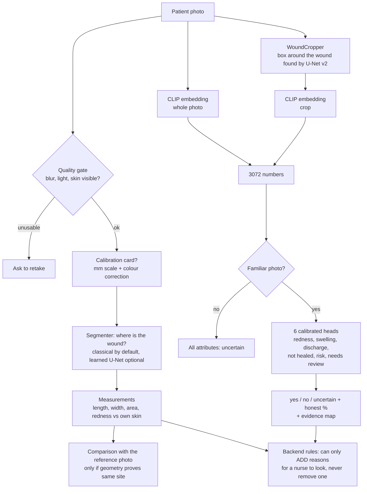

# 08. The wound-photo AI explained from zero: theory, code, and what we did

> For: someone new to computer vision and machine learning who must understand and defend this work.
> Reading time: about 1 hour. No maths beyond fractions and one formula; every idea comes with a small example.
> The step-by-step technical pages are [05](05_SEGMENTATION.md), [06](06_CLASSIFIER_V2.md), [07](07_HUMAN_OUTLINES.md);
> the problems met are in the journal [02](02_PROBLEMS_AND_SOLUTIONS.md). This page ties them together.

**Contents**
- [Part A: the theory, from zero](#part-a-the-theory-from-zero) (A1–A11)
- [Part B: the whole system in one picture](#part-b-the-whole-system-in-one-picture)
- [Part C: the code, file by file](#part-c-the-code-file-by-file)
- [Part D: what we did, step by step, and why](#part-d-what-we-did-step-by-step-and-why)
- [Part E: glossary](#part-e-glossary)
- [Part F: questions you may be asked, with short answers](#part-f-questions-you-may-be-asked-with-short-answers)

---

## Part A: the theory, from zero

### A1. What a computer sees in a photo

A photo is a grid of **pixels**. Each pixel is three numbers between 0 and 255: how much **red, green, blue** light.
A 1024 × 683 photo is 1024 × 683 × 3 ≈ 2 million numbers. OpenCV (the image library we use) stores them in the order
**B, G, R**, which is why the code often says `bgr`.

RGB is how screens work, not how humans see. We often convert to **CIELAB**, a colour space built to match human
vision:
- **L** = lightness (dark → light),
- **a** = green → **red** axis,
- **b** = blue → yellow axis.

Redness of skin is mostly "a goes up", whatever the light. That is why the classical method works in CIELAB
(`colour.py`, `to_lab`).

### A2. Two ways to make a computer understand a photo

| | Hand-written rules ("classical" computer vision) | Learned models (machine learning) |
|---|---|---|
| How | A human writes the steps: "find pixels redder than the skin around them, keep the longest blob" | The computer is shown thousands of examples with answers and finds the rules itself |
| Strength | Explainable, needs no data | Handles messy real photos far better |
| Weakness | Breaks on cases the human did not foresee (jeans seams, pen marks, odd light) | Needs labelled examples; harder to explain |
| In this project | `ClassicalSegmenter` (v1) | `LearnedSegmenter` (U-Net) and the attribute classifier |

Example from your knee photo: the classical rule picked the **seam of the jeans** (it is "darker and redder than its
surroundings"); the learned model outlined the scrape. That is the whole motivation of step 3 in one picture.

### A3. Machine learning in five minutes

- **Example + label.** A photo (input) and the right answer (label), e.g. "this photo shows redness: yes", or a
  mask saying which pixels are wound.
- **Model.** A function with adjustable numbers inside (**parameters** or **weights**): 14 million for our U-Net.
- **Training.** Show the examples, measure how wrong the model is (the **loss**), nudge every weight a little in the
  direction that reduces the loss (**gradient descent**). Repeat thousands of times.
- **Overfitting.** A model can memorise its training photos instead of learning general rules (like a student who
  learns the answers of last year's exam by heart). It looks perfect on photos it has seen and fails on new ones.
- **The three sets (the most important rule of the whole field):**

| Set | Used for | Analogy |
|---|---|---|
| **Train** | adjusting the weights | the exercises you practise on |
| **Validation** | choosing settings and the best moment to stop | the mock exam |
| **Test** | measuring the final quality, **once**, at the end | the real exam, never seen before |

  If you look at the test set while choosing settings, the test score becomes optimistic: you have "studied the
  exam". This is called **leakage**. We avoided it everywhere and wrote down when we came close (journal V19).
- **Cross-validation (CV).** With little data, one validation set is noisy. 5-fold CV cuts the training data into 5
  parts, trains on 4 and checks on the 5th, five times, and averages. Every photo is used for checking once. The
  predictions made this way on photos the model did not train on are called **out-of-fold** predictions.

### A4. Neural networks and convolution

A **convolution** slides a small window (for example 3 × 3 pixels) over the image and computes a weighted sum at each
position. With the right weights, a window detects an edge, a line, a colour change. A **convolutional neural network
(CNN)** stacks dozens of such layers: the first layers detect edges, the middle ones textures and shapes, the last ones
whole objects. The weights of every window are **learned**, not written by hand.

**Transfer learning.** Training a CNN from scratch needs millions of photos. Instead we start from a network already
trained on **ImageNet** (1.2 million everyday photos: dogs, cars, food...). Its early layers already know edges and
textures, which are useful for skin and wounds too. We only need to teach it the last part of the job. That is why
~800 wound photos were enough.

### A5. Segmentation and the U-Net

**Segmentation** = for every pixel, answer "wound or not". The output is a **mask**: an image of the same size where
wound pixels are 1 and the rest 0 (the green outlines in our pictures are the borders of masks).

**U-Net** is the standard network for medical segmentation (it was invented for microscope images in 2015). Its shape:

```
photo 320x320 ──► ENCODER (ResNet18, pretrained on ImageNet)
                  shrinks the image step by step: 160, 80, 40, 20, 10 pixels wide,
                  while learning WHAT is in the picture
                                    │
                  DECODER           ▼
                  grows it back: 20, 40, 80, 160, 320, to say WHERE it is
                  + "skip connections": at each size, the decoder also receives the encoder's
                    picture of the same size, which brings back the fine details lost when shrinking
                    (essential for a 3 mm incision)
                                    │
                                    ▼
                  one number per pixel ("logit") ──► sigmoid ──► probability 0..1 ──► > 0.5 = wound
```

Code: `wound/training/unet.py` (`ResNetUNet`).

**The loss we train with: BCE + Dice** (`dice_bce_loss`).
- **BCE** (binary cross-entropy) punishes each pixel's wrong probability. Problem: a cut can be 1 % of the pixels, so
  a model saying "no wound anywhere" is already 99 % right per pixel.
- **Soft Dice** measures the overlap of the whole predicted area with the true area (see A6). Predicting nothing gives
  overlap 0, so the model cannot cheat. We add the two.

**Data augmentation** (`training/data.py`). Each time a training photo is used, it is randomly rotated, zoomed,
shifted, flipped, made darker or brighter. The model sees "new" photos every time, which fights overfitting and
prepares it for home phone photos. Hue is changed only a little: colour is a medical signal.

**The training loop** (`scripts/train_segmenter.py`):
- one **epoch** = every training photo seen once; we trained 40 epochs (~25 s each on your RTX 2050 GPU);
- photos go in **batches** of 8 (the GPU processes 8 at once);
- **AdamW** is the algorithm that nudges the weights; the **learning rate** is the size of the nudges; **OneCycle**
  starts small, goes up, then down again (a well-known recipe that trains faster and more stably);
- **mixed precision (AMP)** computes in 16-bit numbers where safe: half the memory, faster;
- after each epoch the model is scored on the validation photos and the best version is kept;
- a **checkpoint** (all the training state) is saved every epoch, so a crash costs one epoch (journal V17).

**Letterbox** (`learned.py`, `letterbox`). The network wants a square 320 × 320 input. Squashing a 4:3 photo into a
square would make a cut look 33 % thinner. Instead we shrink the photo to fit and fill the rest with black, like a
film on a TV. The SAME function is used in training and in the app, so the two can never prepare photos differently.

### A6. How to measure a segmentation

Compare the predicted mask with the true mask, pixel by pixel:
- **TP** (true positive): wound pixel, predicted wound. **FP**: not wound, predicted wound. **FN**: wound, missed.
- **Precision** = TP / (TP + FP): of what I drew, how much was really wound.
- **Recall** (sensitivity) = TP / (TP + FN): of the real wound, how much I found.
- **Dice** = 2·TP / (2·TP + FP + FN): one number for both, 0 = no overlap, 1 = perfect.
- **IoU** = TP / (TP + FP + FN): stricter cousin of Dice.

Worked example: true wound 100 pixels; the model draws 120 pixels of which 80 are inside the wound.
TP = 80, FP = 40, FN = 20 → precision 0.67, recall 0.80, Dice = 160 / 220 = **0.73**, IoU = 80 / 140 = 0.57.

**Width ratio** (our addition, `seg_eval.py`): predicted width / true width. A long cut drawn twice too wide still has
Dice 0.67 (looks "okay"), but width ratio 2.0 says exactly what is wrong. The classical method had width ratio ~2
on incisions (journal V14, V15).

### A7. Classifying a photo with an "embedding"

To answer "is there redness?" we do not train a big network (we have only 549 labelled photos). We use a
**frozen encoder**: **CLIP** (by OpenAI), trained on 400 million internet images with their captions. Given a photo,
CLIP outputs an **embedding**: a list of numbers (here 1536) that summarises what the photo looks like. Similar photos
get similar lists. "Frozen" means we never change CLIP's weights; we only read its output.

On top of the embedding, one small **logistic regression** per question ("head"):

```
z = w1·x1 + w2·x2 + ... + w1536·x1536 + b        (a weighted sum of the embedding)
p = 1 / (1 + e^-z)                               (the "sigmoid": squeezes z into a probability 0..1)
```

Training a head = finding the weights w that best separate yes-photos from no-photos. Two details:
- **Class imbalance.** Only 16 of 125 test photos show discharge. Without care the head learns "always say no".
  `class_weight="balanced"` makes each rare positive count more. Side effect: probabilities are pushed towards 0.5
  (fixed by calibration, A9).
- **Regularisation (C).** Limits how large the weights can get, so the head cannot memorise. C is chosen by CV.

Why this design: it trains on a laptop CPU in minutes, cannot overfit much, and every number is inspectable. A
numpy-only copy of each head is stored in `wound_heads.json` + `.npz` (`model_bundle.py`), so the app needs no
scikit-learn and no unsafe pickle files (journal V2).

**Step 4 idea.** CLIP summarises the WHOLE photo, where the wound may be 1 % of the pixels. So we also give it a
**crop around the wound** (found by the U-Net) and join the two embeddings (1536 + 1536 = 3072 numbers).

### A8. How to measure a classifier

- A head outputs a probability; we pick a **threshold**: above = "yes". Each choice trades **sensitivity**
  (of the photos that truly have the sign, how many we flag) against **specificity** (of the photos without it, how
  many we correctly leave alone). We chose thresholds for **sensitivity ≥ 0.85**: missing a sign is worse than a
  false alarm, and a nurse looks at every flag anyway.
- **AUROC** measures ranking quality independently of any threshold. Intuition: pick one random photo WITH the sign
  and one WITHOUT; AUROC is the chance the model gives the first a higher score. 0.5 = coin flip, 1.0 = perfect.
  Our redness head: 0.77; the old OpenCV redness rule: 0.50 (a coin flip, journal).
- **Bootstrap confidence interval.** With 137 test photos, scores are noisy. We resample the test photos with
  replacement 1000 times and recompute; the middle 95 % of results is the **95 % CI**. "[0.67, 0.85]" means "the true
  value is very probably in this range". If two models' difference CI excludes 0, the difference is real.
- **Abstention.** Close to the threshold the model says **"uncertain"** instead of guessing (the band).
- **Unfamiliar-photo gate (OOD).** If a new photo's embedding is far from every training photo (distance to its 5
  nearest training photos above what 97.5 % of training photos have), the model abstains on everything. Your knee
  photo passed (distance 0.145, limit 0.175).

### A9. Calibration: does "70 %" really mean 70 %?

A model is **calibrated** if, among all photos where it says 70 %, about 70 % really have the sign. Our heads were
not: class weighting pushed probabilities towards 0.5, so "30 % discharge" was said far too often.

- **ECE** (expected calibration error): sort predictions into 10 bins (0–10 %, 10–20 %, ...), compare the average
  prediction with the real frequency in each bin, average the gaps. 0 = perfect.
- **Brier score**: average of (probability − truth)², truth being 0 or 1. Lower is better.
- **Platt scaling** (the fix): take the head's raw score z and compute p = sigmoid(a·z + c), with a and c fitted on
  out-of-fold predictions (never on test). **Temperature scaling** is the same with c = 0; it cannot fix the shift from
  class weighting, which is why Platt won.
- Calibration only stretches and shifts the scores; it never changes their order, so **AUROC cannot change**. And we
  made sure the yes / no / uncertain decisions do not change either (journal V24): only the percentage shown becomes
  honest. Result: discharge ECE 0.22 → 0.06; mean predicted swelling 15 % vs true rate 18 %.

### A10. Running a model inside the app: ONNX

Training needs PyTorch with GPU support (2.5 GB). The app must stay light. So the trained U-Net is exported to
**ONNX**, a standard file format for neural networks, and run with **onnxruntime** (a small CPU library already in the
backend). One 58 MB file contains the whole network; it runs in ~0.2 s per photo on a laptop CPU.

### A11. Scientific honesty rules we followed

1. **Test set used once**, at the end. Settings chosen by CV on train + validation only.
2. **Pre-registration**: for the crop experiment (step 4), the rule to choose the winner was written before looking at
   any test number.
3. **Paired comparisons**: compare two models on the same photos and bootstrap the difference.
4. **No leakage**: the segmenter never saw a classifier test photo; outline test photos come from SurgWound's own test
   split.
5. **Report the bad news**: the size-floor fix found by looking at test failures (V19), the AI-drafted outlines
   rejected at review (V25), sensitivities below target on test. All in the docs.
6. **Labels checked by someone other than who made them** (the lesson of V25).

---

## Part B: the whole system in one picture



Two branches: **measurement** (pipeline.py: how big, how red, changed since last time?) and **attributes**
(model.py: what would a surgeon say about this photo?). Both feed the backend, which never closes a case on its own.

---

## Part C: the code, file by file

All wound code is in `d1/src/surgiguard_d1/wound/`. Scripts are in `d1/scripts/`, tests in `d1/tests/`.

### C1. The measurement pipeline (v1 → v2 steps 1–2)

| File | What it does | Design idea |
|---|---|---|
| `pipeline.py` | `WoundAnalyzer.analyze(photo)`: runs quality → calibration → segmentation → measurement → comparison | **Facade**: one simple entry point over many parts; the segmenter is **injected** (any `Segmenter` works) |
| `config.py` | every number (limits, kernel sizes) in one place | no "magic numbers" scattered in code |
| `colour.py` | loading, CIELAB conversion, skin mask | small pure helpers |
| `quality.py` | refuses blurry, dark, skin-less photos ("garbage in, garbage out") | first gate, everything after trusts it |
| `calibration.py`, `card_render.py` | the printed card: ArUco markers give the scale in mm and fix perspective; grey patches fix the colour of the light | real-world units instead of pixels |
| `segmentation.py` | `Segmenter` protocol + `ClassicalSegmenter` + `finish_segmentation` (shared final step) | **Strategy** pattern: many interchangeable ways to segment |
| `measurement.py` | length, width, area, redness compared with the patient's own skin around the wound | relative measures cancel the light |
| `registration.py` | proves two photos show the same site (ORB keypoints + RANSAC) before comparing | never report "change" between two different places |
| `render.py` | draws the overlay picture | |

### C2. Learned segmentation (step 3)

| File | What it does |
|---|---|
| `learned.py` | `LearnedSegmenter`: letterbox → normalise → ONNX U-Net → probability → mask → `finish_segmentation`. Same interface as the classical one, so `WoundAnalyzer(segmenter=LearnedSegmenter("...onnx"))` just works (**Open/Closed principle**: extend without modifying) |
| `training/unet.py` | the U-Net (ResNet18 encoder) and the BCE + Dice loss |
| `training/data.py` | letterbox + augmentation for training, deterministic train/validation split |
| `seg_eval.py` | Dice, IoU, precision, recall, width ratio; `SegmenterBenchmark` grades ANY segmenter with the same code |
| `seg_data.py` | `MaskFolder`: the only code that knows the folder layout `images/` + `labels/` (**DRY**: one definition) |
| `annotation.py` | the logic of the click tool: `Stroke` (line along a cut) and `Polygon` (around a wound), undo, snapping |
| `scripts/outline_wounds.py` | the window you draw in; only translates clicks and keys into `annotation.py` calls (**Humble Object**: the logic is tested without a screen) |
| `scripts/train_segmenter.py` | training with checkpoints, `--resume`, `--init` (fine-tuning), `--weights` (oversampling), ONNX export |
| `scripts/compare_segmenters.py` | classical vs any ONNX models on one test set, printed as a table |
| `scripts/after_outlines.ps1` | the one command after human outlining (07) |

How the learned segmenter works, in the code's order (`learned.py`, `LearnedSegmenter.segment`):
1. `letterbox(photo, 320)`: fit into a 320 × 320 square without distortion.
2. `normalise`: BGR → RGB, divide by 255, subtract ImageNet's mean colour and divide by its spread (the encoder was
   trained on numbers in that range).
3. `session.run(...)`: onnxruntime runs the U-Net → one logit per pixel.
4. sigmoid → probability; `unletterbox` back to the photo's size; `> 0.5` → mask.
5. remove pixels on the calibration card, drop tiny specks, then `finish_segmentation` (size checks + the colour of
   the skin around the wound, needed by `measurement.py`).

### C3. The attribute classifier (step 4)

| File | What it does |
|---|---|
| `model.py` | `predict(photo)`: `photo_features` (CLIP of whole photo + CLIP of the crop) → unfamiliar-photo gate → 6 heads → yes/no/uncertain; `occlusion_map` = evidence map |
| `crop.py` | `WoundCropper(segmenter)`: square box around the mask, 35 % extra skin around it, falls back to the whole photo if no wound is found |
| `prob_calibration.py` | Platt / temperature scaling, ECE, Brier |
| `model_bundle.py` | the numpy-only heads (`LinearHead`), the gate (`OODGate`), saving/loading (format version 2 adds calibration; version 1 files still load) |
| `scripts/train_wound_model.py` | trains the 6 heads: CV to pick C, threshold for sensitivity ≥ 0.85, Platt calibration, test once, saves the bundle |
| `scripts/wound_view_experiment.py` | the pre-registered "whole vs crop vs both" comparison |

**The evidence map** (`occlusion_map`): cover one square of a 5 × 5 grid in grey, re-run the model, see how much the
redness probability drops. Big drop = that square mattered. Repeat for the 25 squares → heat map. Simple, honest, and
works for any model. On your knee photo the red area was on the wound itself, not on the jeans.

### C4. Backend side (`backend/app/integrations/`)

`d1_wound.py` calls `analyze()` and `model.predict()`; `wound_rules.py` turns results into reasons for review using
the **Strategy** pattern again (each rule is a small class); `wound_views.py` adapts results for the patient and the
nurse (**Adapter**). Rule: the AI can only ADD a reason for a nurse to look; it never removes one.

### C5. Tests

`d1/tests/test_wound_*.py`: 74 wound tests. They use **synthetic ground truth** (drawn images where the right
answer is known exactly, e.g. a red bar of known width) and **fakes** (a pretend segmenter or ONNX session), so they
run in seconds without a GPU. Totals: d1 241 passed, backend 194 passed.

---

## Part D: what we did, step by step, and why

| Step | Problem | What we did | Result | Doc |
|---|---|---|---|---|
| v1 (hackathon) | find and measure a wound from a phone photo, without any training data | hand-written rules in CIELAB + an attribute model on CLIP | worked on clean photos; one big file | 01 |
| v2 step 1 | one huge file, impossible to test or extend | split into modules with one job each; patterns (Facade, Strategy); portable model files | same outputs, proven equal; easy to extend | 03 |
| v2 step 2 | sizes in pixels depend on the camera distance; colours depend on the light | printed calibration card: mm and colour correction | on the true outline, real-size geometry within 5 % on ground-truth test images | 04 |
| v2 step 3 | the classical segmenter fails on messy photos (jeans seams) and draws cuts 2× too wide | a fair yardstick (Dice, width ratio), the click tool, a U-Net trained on 810 expert-outlined ulcer photos (FUSeg), exported to ONNX | ulcers: Dice 0.82 vs 0.17 for classical; incision results waiting for human outlines | 05 |
| v2 step 4 | the classifier looked at the whole scene; its percentages were misleading | classify whole photo + wound crop (chosen by a rule fixed in advance), calibrate the probabilities | swelling AUROC 0.77 → 0.81, discharge 0.82 → 0.87; discharge ECE 0.22 → 0.06 | 06 |
| final step | AI-drafted incision outlines rejected at human review | guide + one command; Ines outlines, the rest is automatic | to do | 07 |

The datasets:
- **FUSeg** (Foot Ulcer Segmentation Challenge, MICCAI 2021): 1 010 foot-ulcer photos with masks drawn by experts.
  Used to teach the U-Net what a wound looks like.
- **SurgWound** (Hugging Face, CC BY-SA 4.0): 686 surgical-wound photos labelled by surgeons (redness, swelling,
  discharge, healing, risk, urgency), no masks. Used for the attribute classifier, and its photos for the incision
  outlines.

---

## Part E: glossary

| Term | Meaning |
|---|---|
| AMP | mixed precision: compute in 16-bit numbers where safe; less GPU memory, faster |
| Augmentation | random changes to training photos so the model sees more variety |
| AUROC | chance that a random positive photo gets a higher score than a random negative one (0.5 = chance, 1 = perfect) |
| Batch | photos processed together in one training step |
| BCE | binary cross-entropy, the standard loss for yes/no outputs |
| Bootstrap | resampling the test set many times to get a confidence interval |
| Brier score | mean of (probability − truth)²; lower = better probabilities |
| Calibration | making "70 %" mean 70 % |
| Checkpoint | the full training state saved to disk, to resume after a crash |
| CIELAB | a colour space close to human vision: L lightness, a green→red, b blue→yellow |
| CLIP | an image encoder trained on 400 million image–caption pairs; we use it frozen |
| CNN | convolutional neural network |
| Cross-validation | train on 4/5, check on 1/5, five times; uses all data for checking |
| Dice | overlap score of two masks, 0..1 |
| ECE | expected calibration error: average gap between predicted % and real frequency |
| Embedding | a list of numbers summarising an image; similar images, similar lists |
| Encoder / decoder | the part of a network that summarises / the part that rebuilds a detailed output |
| Epoch | every training photo seen once |
| Fine-tuning | continue training an already trained model on new data |
| Ground truth | the correct answer (here: true outlines or surgeon labels) |
| IoU | intersection over union, stricter overlap score |
| Leakage | test information influencing training or choices; makes results look better than they are |
| Letterbox | fit an image into a square without distortion by padding |
| Logistic regression | weighted sum + sigmoid → probability |
| Logit | the raw score before the sigmoid |
| Loss | how wrong the model is; training lowers it |
| Mask | image saying which pixels are wound |
| ONNX / onnxruntime | standard file format for networks / small library that runs it |
| OOD | out-of-distribution: a photo unlike the training photos |
| Overfitting | memorising training examples instead of learning general rules |
| Platt scaling | calibration p = sigmoid(a·z + c) |
| Precision / recall | of what I flagged, how much was right / of what was there, how much I found |
| Pre-registration | fixing the decision rule before seeing the test results |
| Segmentation | labelling every pixel |
| Sensitivity / specificity | share of positives caught / share of negatives correctly left alone |
| Sigmoid | squeezes any number into 0..1 |
| Skip connection | U-Net link that brings fine details from the encoder to the decoder |
| Transfer learning | reusing a network trained on another big dataset |
| U-Net | encoder–decoder network for segmentation |

---

## Part F: questions you may be asked, with short answers

**Why not train one big network end to end?**
549 labelled photos for the attributes are far too few; a big network would memorise them. A frozen pretrained
encoder + small linear heads is the standard, robust choice for small medical datasets, and it stays explainable.

**Why a U-Net and not the classical method?**
On 200 unseen ulcer photos the U-Net reaches Dice 0.82, the classical method 0.17. The classical rule is fooled by
anything darker and redder than its surroundings (seams, pen marks) and draws cuts about twice too wide.

**How do you know you did not cheat on the test set?**
Settings were chosen by cross-validation on train + validation; the test set was scored once; the crop experiment's
decision rule was written before seeing test results; one exception (the size floor, V19) is disclosed with both
numbers.

**What does AUROC 0.87 for discharge mean?**
If you take a photo with discharge and one without, the model ranks the first higher 87 % of the time.

**Why calibrate if AUROC does not change?**
Because people read the percentage. Before calibration "30 %" was misleading; after it, the average predicted rate
matches the real rate. The decisions themselves were kept identical.

**What are the limits?**
SurgWound photos come from the internet, not from our patients' phones; test sets are small (wide CIs); the incision
outlines must be redone by a human (07); the model describes what surgeons see in a photo, it does not diagnose, and it
can only add reasons for review.

**What was the hardest problem?**
Good candidates from the journal: the out-of-memory crashes during training and how checkpoints fixed them (V17, V21);
the safety rule that hid 24 correctly found wounds (V19); calibration silently changing decisions (V24); the rejected
AI outlines (V25).

**What design patterns did you use and where?**
Strategy (segmenters, review rules), Facade (`WoundAnalyzer`), Adapter (legacy model loader, backend views), value
objects (immutable results), Humble Object (the drawing window), dependency injection (the segmenter given to the
analyser and the cropper). DRY: one owner for each piece of knowledge (folder layout, preprocessing, label
definitions).
